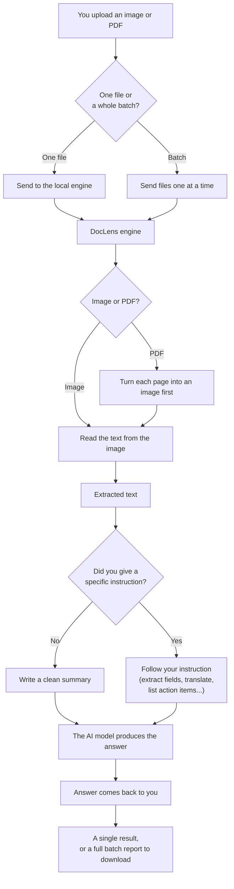

# DocLens: Read, Understand, and Summarize Documents — Without the Cloud

*A local-first tool that turns images and PDFs into answers, running entirely on one laptop.*

---

## The everyday problem

Every organization drowns in documents. Invoices, receipts, delivery notes, memos, scanned forms. Getting useful information out of them usually means one of two things: someone reads each one by hand and types the important bits into a spreadsheet, or the documents get uploaded to a cloud service that reads them for a fee.

Both approaches have a cost. Manual entry is slow and error-prone. Cloud services are fast, but they charge for every page, they need an internet connection, and — the part that makes legal, medical, and finance teams nervous — your documents leave your building to get processed on someone else's servers.

DocLens was built to ask a simple question: **what if a single laptop could read a document, understand it, and answer questions about it — with nothing ever leaving the machine?**

---

## What DocLens does, in plain terms

You give it an image or a PDF. It does three things:

1. **Reads the text off the page** — the same way a person's eyes would, turning pixels into words.
2. **Understands what you want** — by default it writes a clean summary, but you can also just tell it what you need: "pull out the invoice number and total," "translate this and summarize it," "list the action items."
3. **Hands you the answer** — one document at a time, or a whole folder at once.

That's it. No accounts, no API keys, no per-page bill, no internet required once it's set up.

Here's the journey a document takes, from upload to answer:

Everything in that diagram happens on your own device. (An editable version of this flow lives in [`docs/doclens-flow.drawio`](docs/doclens-flow.drawio).)

---

## Why this is different

Most tools that "read documents" send them to the cloud. Most tools that run locally can't handle a model powerful enough to actually understand what they read. DocLens sits in the rare middle: a genuinely capable AI model, running fully offline, on ordinary hardware.

Here's how it compares to the usual options, in everyday terms:

| What matters to you | Typical cloud service | A basic local script | **DocLens** |
|---|---|---|---|
| Do my documents leave my machine? | Yes — uploaded to a vendor | No | **No** |
| Cost per document | ~1–3 cents per page, forever | Free | **Free after setup** |
| Works without internet? | No | Sometimes | **Yes** |
| Can it actually *understand*, not just read? | Yes | Usually not | **Yes** |
| Can I ask for exactly what I need? | Sometimes | Rarely | **Yes — plain-language instructions** |
| Special hardware needed? | No (it's their servers) | No | **No — runs on a laptop** |

The short version: **DocLens gives you cloud-grade document understanding with local-grade privacy and zero ongoing cost.**

---

## The engine under the hood

The "understanding" part is powered by an open-source AI model called [edge0](https://github.com/Edge0-AI/edge0). What makes it special isn't just that it's smart — it's that it's smart *and* small enough to run on a laptop, which is normally a contradiction.

Large AI models usually need expensive graphics cards and gigabytes of memory. edge0 uses three clever tricks to sidestep that:

- **It only loads the parts of its "brain" it needs, when it needs them.** Instead of holding the entire model in memory, it streams the relevant pieces from the hard drive on demand. The result: a model with the knowledge of a very large one, but the memory footprint of a small one (about 2.9 GB in use, versus 23 GB sitting on disk).
- **It looks one step ahead.** It predicts which parts of its brain the next word will need and fetches them in advance, so it never has to pause and wait. This makes it noticeably faster.
- **It recovers the accuracy lost from being compressed.** Shrinking a model to fit on a laptop normally makes it dumber. edge0 uses a training technique to win most of that quality back.

For the technically curious: edge0-35b is a 4-bit quantized, 35-billion-parameter Mixture-of-Experts model (built on Qwen3.6-35B-A3B), running on Apple Silicon via MLX, using SSD expert offload, prerouter routing prediction, and Recover-LoRA adapters. On a Mac Mini M4 Pro it generates 15–18 words' worth of text per second and loads in about a second. That combination — a 35-billion-parameter-class model running comfortably on a consumer Mac with no graphics card — is genuinely uncommon.

---

## Does it actually work? The numbers.

It's easy to claim a tool is accurate. We wanted to measure it. So we built a small, repeatable test using four realistic documents — an invoice, a receipt, an internal memo, and a shipping label — where we already knew the correct answer for every field. Then we ran them through the *real* DocLens pipeline and scored the results two ways:

- **Reading accuracy:** how often did it get the characters and words right?
- **Answer accuracy:** when asked to pull out specific details (invoice number, date, total, and so on), how many did it get exactly right?

Here are the results:

| What we measured | Score | In plain terms |
|---|---|---|
| Character reading errors | 2.1% | About 2 characters in 100 misread |
| Word reading errors | 5.9% | About 6 words in 100 imperfect |
| Correct field extraction | **12 out of 12 (100%)** | Every requested detail pulled out correctly |

The most interesting result is the last row. Even on the one document where the text-reading was noisiest (a shipping label where a comma got misread as a semicolon), the AI still correctly extracted all the fields we actually asked for. In other words: the model is smart enough to find the right answer even when the raw reading isn't perfect.

**An honest note on these numbers.** This test used four clean, computer-generated documents. That proves the pipeline works correctly end to end — but it is *not* a promise that it will hit the same accuracy on crumpled receipts, faint photocopies, handwriting, or other languages. The test is fully reproducible (it lives in the [`evaluation/`](evaluation/) folder), and anyone planning to rely on DocLens should re-run it against a sample of their own real documents first.

---

## Where DocLens fits — and where it doesn't

DocLens is a strong fit when you want:

- **Privacy by default** — sensitive documents (legal, medical, financial, HR) that shouldn't touch the cloud.
- **Zero ongoing cost** — high document volume where per-page fees would add up.
- **Offline capability** — environments with no reliable internet, or where connectivity is deliberately restricted.
- **Flexibility** — the ability to ask for different things from different documents without reconfiguring anything.

It is **not** the right tool if you need:

- **Guaranteed accuracy at scale** on messy, real-world scans without human review.
- **Complex layout understanding** — dense multi-column pages, intricate tables, or forms where spatial position carries meaning.
- **Languages beyond English** — support there is limited today (more on this below).
- **Many users at once** — it's built to serve one request at a time, so it suits an individual or a small team, not a busy shared service.

---

## The fine print (the honest caveats)

Every tool has edges. Here are DocLens's, stated plainly rather than buried:

- **Reading quality depends on the document.** Clean, printed English text reads very well. Handwriting, low-quality scans, skewed photos, and non-Latin scripts are all harder, and accuracy drops accordingly.
- **No Word-document (DOCX) support yet.** DocLens reads images and PDFs. Word files store text differently and would need an extra conversion step we haven't added.
- **A note on the reading engine.** Our first choice of text-reading library (PaddleOCR) turned out to freeze indefinitely on Apple Silicon Macs — a known, unresolved issue we hit directly in testing. We switched to EasyOCR, which runs reliably on this hardware. On other platforms (Linux, or machines with a graphics card), the original choice may work fine.
- **Non-English is still an open frontier.** We specifically investigated Tamil, and found the reading engine's Tamil model is currently broken in its published version. The underlying AI model likely understands Tamil, but the reading step can't reliably feed it Tamil text yet. This is a real opportunity, not a shipped feature.
- **Privacy is about the whole system, not just where it runs.** DocLens makes no internet calls today, which is a strong privacy position. But "runs locally" only stays a privacy guarantee as long as nothing is later added that logs, stores, or sends data elsewhere. As shipped, it's clean; that's a property to protect, not to assume forever.
- **Compression has a small quality cost.** Shrinking the AI model to run on a laptop makes it very slightly less capable than the full-size version (a few percentage points on standard tests). For high-stakes details — legal or financial figures — treat the output as a well-informed draft to verify, not a final word.
- **No login or access control.** It's designed to run on your own machine. It should not be put on a shared network or the internet without adding proper security first.

---

## The takeaway

DocLens is a focused answer to a specific, common need: read everyday documents, understand them, and get exactly the information you want — quickly, for free, and without a single byte leaving your machine.

It won't replace an enterprise document platform for complex, high-volume, mission-critical processing. But for private, practical, everyday document work on hardware you already own, it's a genuinely capable tool — and a small demonstration that serious AI no longer requires the cloud.
